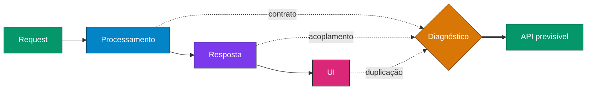

<div align="center">

<picture>
  <source media="(prefers-color-scheme: dark)" srcset="https://readme-typing-svg.demolab.com?font=JetBrains+Mono&weight=700&size=28&duration=2600&pause=800&color=00FF9C&center=true&vCenter=true&multiline=false&width=860&height=55&lines=%24+whoami+%E2%86%92+Thiago+Nogueira;%24+cat+books.txt+%7C+wc+-l+%E2%86%92+23%2B+livros+de+TI;%24+deploy+--env%3Dproduction+%E2%9C%94;Sistemas+quebram.+Arquitetos+antecipam."/>
  
</picture>

### ⚡ Construo sistemas que continuam funcionando quando a pressão começa.
Atuo onde a complexidade não é opcional — e decisões técnicas têm impacto real.

<a href="https://www.pensarbem.com.br"></a>
<a href="https://www.pensarbem.com.br/tecnologia"></a>
<a href="https://www.pensarbem.com.br/pt/zettelkasten"></a>
<a href="https://www.instagram.com/pensar_bem_/"></a>

</div>


```yaml
engineer:
  name: Thiago Nogueira
  role: [Software Architect, Backend Engineer, Educational Architect, Author]
  focus: [distributed-systems, critical-apis, reliability, ai-engineering]
  domains: [fintech, insurance, edtech]
  books: "30+ títulos técnicos — série One (Editora Pensar Bem)"
  second_brain: zettelkasten   # A Caixa Mágica
  motto: "Sistemas quebram. Bons engenheiros reagem. Arquitetos antecipam."
```

<p align="center">
  <br/>
  
</p>


## `> ls ./books --series=one`

> 🎓 **Autointitulado e proclamado — por falta de objeções — Arquiteto Educacional.**
> Monto cursos e livros sobre os mais variados assuntos da área de tecnologia.

- 🔥 Abaixo, alguns dos meus livros mais vistos ultimamente.
- 🧠 Meu maior case é algo que parece nada a ver, mas tem tudo a ver: **Zettelkasten — A Caixa Mágica**. Para mim, é a cola de todo o meu conhecimento.

<h3></h3>
<sub>Linguagens — da base ao runtime</sub>

<table align="center">
  <tr>
    <td align="center" width="25%"><a href="https://www.pensarbem.com.br/java-one"></a><br/></td>
    <td align="center" width="25%"><a href="https://www.pensarbem.com.br/c-sharp-one-v1"></a><br/></td>
    <td align="center" width="25%"><a href="https://www.pensarbem.com.br/c-sharp-one-v2"></a><br/></td>
    <td align="center" width="25%"><a href="https://www.pensarbem.com.br/python-one"></a><br/></td>
  </tr>
  <tr>
    <td align="center" width="25%"><a href="https://www.pensarbem.com.br/javascript-one"></a><br/></td>
    <td align="center" width="25%"><a href="https://www.pensarbem.com.br/php-one-v1"></a><br/></td>
    <td align="center" width="25%"><a href="https://www.pensarbem.com.br/php-one-v2"></a><br/></td>
    <td align="center" width="25%"><a href="https://www.pensarbem.com.br/ruby-one"></a><br/></td>
  </tr>
  <tr>
    <td align="center" width="25%"><a href="https://www.pensarbem.com.br/c-one"></a><br/></td>
    <td align="center" width="25%"><a href="https://www.pensarbem.com.br/assembly-one"></a><br/></td>
    <td align="center" width="25%"><a href="https://www.pensarbem.com.br/cobol-one"></a><br/></td>
    <td align="center" width="25%"><a href="https://www.pensarbem.com.br/sql-one"></a><br/></td>
  </tr>
</table>

<h3></h3>
<sub>Do commit à produção, sob carga real</sub>

<table align="center">
  <tr>
    <td align="center" width="25%"><a href="https://www.pensarbem.com.br/linux-one"></a><br/></td>
    <td align="center" width="25%"><a href="https://www.pensarbem.com.br/git-one"></a><br/></td>
    <td align="center" width="25%"><a href="https://www.pensarbem.com.br/docker-one"></a><br/></td>
    <td align="center" width="25%"><a href="https://www.pensarbem.com.br/kubernets-one"></a><br/></td>
  </tr>
  <tr>
    <td align="center" width="25%"><a href="https://www.pensarbem.com.br/cloud-one"></a><br/></td>
    <td align="center" width="25%"><a href="https://www.pensarbem.com.br/cicd-one"></a><br/></td>
    <td align="center" width="25%"><a href="https://www.pensarbem.com.br/mensageria-one"></a><br/></td>
  </tr>
</table>

<h3></h3>
<sub>IA como alavanca de engenharia</sub>

<table align="center">
  <tr>
    <td align="center" width="25%"><a href="https://www.pensarbem.com.br/ai-one-v1"></a><br/></td>
    <td align="center" width="25%"><a href="https://www.pensarbem.com.br/ai-one-v2"></a><br/></td>
    <td align="center" width="25%"><a href="https://www.pensarbem.com.br/ai-one-v3"></a><br/></td>
    <td align="center" width="25%"><a href="https://www.pensarbem.com.br/ai-one-v4"></a><br/></td>
  </tr>
</table>

<p align="center">
  <a href="https://www.pensarbem.com.br/tecnologia"></a>
  <a href="https://pensarbem.hotmart.host/vitrine-pensar-bem"></a>
</p>


## 🏆 `> menção --honrosa`

<table align="center">
  <tr>
    <td width="220" align="center">
      <a href="https://www.pensarbem.com.br/pt/zettelkasten"></a>
    </td>
    <td>

### 🧠 A Caixa Mágica — Zettelkasten
O livro que não é sobre código, mas está por trás de todos os outros.

O Zettelkasten é o **sistema operacional do meu conhecimento**: notas atômicas, conectadas, que viram livros, cursos e decisões de arquitetura.

```bash
$ zettel link --from "ideia solta" --to "livro publicado"
✔ 30+ títulos gerados a partir da mesma caixa
```

🌍 Publicado em **15 idiomas** — Magic Box, Caja Mágica, Die magische Schachtel, 魔法盒子, 마법 상자 e mais.

<a href="https://www.pensarbem.com.br/pt/zettelkasten"></a>

  </td>
  </tr>
</table>


## `> cat value.log`

```diff
+ Sistemas distribuídos sob carga real
+ APIs críticas (fintech / seguros)
+ Diagnóstico e correção de sistemas instáveis
+ Tradução de complexidade em execução clara
+ IA como alavanca de engenharia
```

## `> trace --system`

Mais do que construir, eu **analiso e estabilizo sistemas existentes**.



- Mapeamento completo de fluxo, ponta a ponta
- Identificação de inconsistências de contrato
- Redução de acoplamento entre frontend e backend
- Eliminação de lógica duplicada
- Padronização de comunicação (API previsível)

## `> git log --building`

```bash
* a1f9c3e feat: edtech — plataforma de aprendizado gamificado
* 7b2e8d1 refactor: arquitetura simples, escalável e sustentável
* 3c4d5f0 perf: redução de dívida cognitiva em produtos complexos
* 9e0a7b2 docs: novos volumes da série One
```

## `> activity --live`

<p align="center">
  <br/><br/>
  
</p>

<div align="center">

```
Sistemas quebram.
Bons engenheiros reagem.
Arquitetos antecipam.
```

<a href="https://www.pensarbem.com.br/tecnologia"><b>→ Aprenda com os livros: pensarbem.com.br</b></a>

</div>


